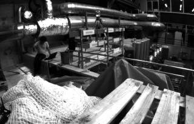
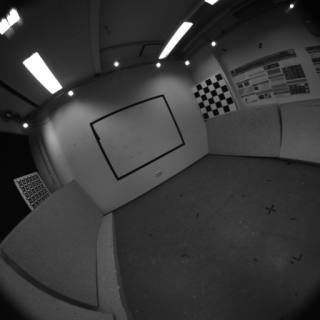
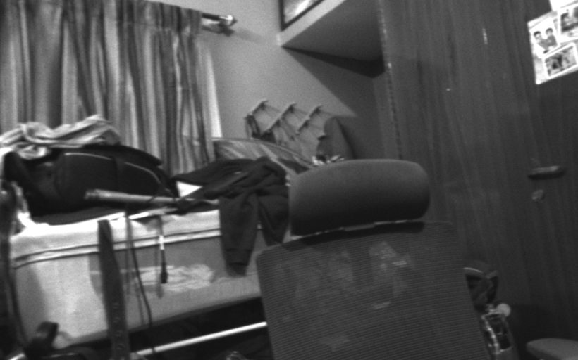
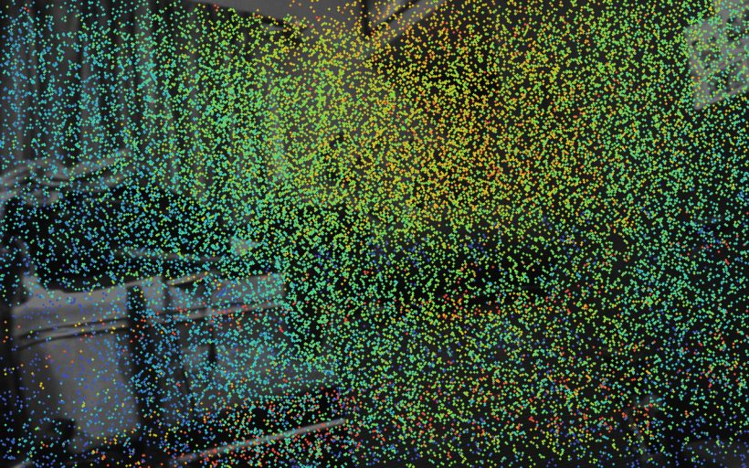

# Stereo SLAM: public-dataset validation, OV9281 root-cause, and 3D reconstruction

**Period:** 2026-08-02 → 2026-08-04 · **Machine:** Raspberry Pi 5 + Hailo-10H (bench tier) · **All numbers measured on-bench** (see `bench/benchlog.md` for provenance).

This document ties together three threads: (1) validating ORB-SLAM3 stereo on public datasets, (2) diagnosing why our own OV9281 CamArray "couldn't" do stereo SLAM — and overturning that verdict, and (3) reconstructing a room from the OV9281 and checking it by reprojection.

> **Headline correction.** An earlier conclusion (commits `dafdb70`, `4d59735`, `1326a4a`) held that the OV9281 CamArray is fundamentally incapable of stereo SLAM — "near-random descriptors, a hardware wall." **That is wrong and is retracted.** The OV9281 stereo pair works; the failure was a broken stereo **calibration**. With a correct calibration it tracks cleanly (2 dropped frames / 207). See Part 3.

---

## Interactive results (the screens)

Self-contained copies are committed under [`docs/viewers/`](viewers/); the live interactive versions:

| Screen | What it shows | Link |
|---|---|---|
| **SLAM trajectory review** | EuRoC MH_01 + TUM-VI room1 estimated vs groundtruth, per-pose error, camera frames | https://claude.ai/code/artifact/9f2cbfb9-3fbd-4793-b15b-c8be5e605bd2 |
| **OV9281 room reconstruction** | 30k-point stereo cloud + camera path, photo-textured, real camera frames | https://claude.ai/code/artifact/c7e6ff62-1edf-4295-b8cc-cd4e84d3a668 |
| **Reprojection check** | the 3D cloud reprojected onto real camera frames (drag to compare) | https://claude.ai/code/artifact/3e10967b-0343-4bec-9182-fe17533361ca |

---

## Part 1 — ORB-SLAM3 stereo on public datasets

ORB-SLAM3 stereo (GPL-3.0, **bench/eval only**, behind `IFrontEnd`, not-product-cleared) builds and runs headless in an aarch64 Ubuntu-22.04/GCC-11 container on the Pi 5. Validated on two public sets:

| Dataset | Camera | Frames tracked | Front-end | Keyframes | ATE RMSE | Path |
|---|---|---|---|---|---|---|
| **EuRoC MH_01** | pinhole 752×480 GS | 3682 | 22.8 fps | 150 | **4.66 cm** | 80.5 m |
| **TUM-VI room1** | fisheye 512×512 | 2821 | 19.1 fps | 178 | **7.79 cm** | 146.4 m |

Both are pure stereo (no IMU); TUM-VI's fisheye is costlier to unproject (19.1 < 20 Hz) and its 7.79 cm is a fair pure-stereo figure (the paper's room1 numbers are stereo-*inertial*). Accuracy is SE(3)-aligned (Umeyama, no scale) vs each set's groundtruth. A shipped-config bug in ORB-SLAM3 was fixed along the way (`Stereo/TUM-VI.yaml` used `Camera.overlappingBegin` where the loader needs `Camera1.overlappingBegin`).

 

*Left: EuRoC MH_01 (pinhole machine hall). Right: TUM-VI room1 (fisheye).*

---

## Part 2 — Pixel density → front-end cost (our camera vs the datasets)

The public sets are **lower** resolution than our cameras (EuRoC 0.36 MP, TUM-VI 0.26 MP; OV9281 1.02 MP, IMX296 1.58 MP). In VIO more pixels is a **cost**, not a benefit. Measured on the OV9281 clip (`nFeatures` fixed at 1200, garuda-depth off, no throttle):

| Resolution | MP | median track | front-end fps |
|---|---|---|---|
| 1280×800 | 1.02 | 60.9 ms | 16.2 |
| 960×600 | 0.58 | 39.9 ms | 24.2 |
| 640×400 | 0.26 | 26.9 ms | 35.7 |

Linear fit on this Pi: **front-end ms ≈ 15 + 44 × megapixels** (fixed descriptor/match cost + per-pixel pyramid/FAST). Predicts IMX296-at-native (1.58 MP) ≈ 11.7 fps — i.e. **downscale the IMX296 toward the ~0.3–0.5 MP EuRoC/TUM-VI regime** and keep the global shutter + sync that actually matter. Harness: `bench/ov9281-stereo/ov_sweep.sh`.

---

## Part 3 — The OV9281 stereo investigation (the important one)

The prior verdict was that the OV9281 CamArray produces near-random stereo descriptors and cannot do SLAM. Pushed on that, a controlled re-investigation overturned it. The arc, with the honest wrong turns included:

### 3.1 It's not the sensor, and not our rectification code
A controlled correspondence battery (identical funnel on EuRoC vs OV9281; our `rectify_clip.py` maps vs a clean `cv2.stereoRectify`) showed: the funnel code works (EuRoC 765/1000 good matches, Hamming 27), and our rectification is bit-identical to a clean reference. So neither was the bug. *(`bench/ov9281-stereo/stereo_corr_battery.py`)*

### 3.2 The pair is valid stereo — the calibration mis-rectifies it
Free descriptor matching (no epipolar constraint) on OV9281 cam0↔cam1 gives **~900 matches, median Hamming 26**, and **80% fit a single fundamental matrix** — a geometrically consistent stereo pair. But with the stored calibration, true correspondences land **113 px off their epipolar rows** at negative disparity, so ORB-SLAM3's same-row search rejects them all. The old "Hamming ~100 random" reading was measured *under* the broken rectification. *(`dydx_diag.py`, `recover_pose.py`)*

### 3.3 The existing calibration is broken and unrecoverable
Re-running the project calibration reproduces it exactly (stereo RMS 1.26 px) — but it **doesn't rectify its own checkerboard captures** (126 px corner error). A clean-room `stereoCalibrate` on the same captures gives 29.7 px. The checkerboard set's L/R correspondences are fundamentally inconsistent → recalibration from existing data is impossible; a fresh shoot is needed.

### 3.4 Scene self-calibration, and a subtle trap
Fitting extrinsics from the scene got ORB-SLAM3 from 1 KF (dead) to tracking. But **self-cal from a *moving* clip is poisoned**: the camera's motion between the two un-synced grabs inflates the recovered inter-camera rotation (true ~2.4° → a bogus 7.5°). Fit from **still** frames and the true 2.41° geometry emerges, rectifying to sub-pixel. *(`self_calib.py`, `move_analysis.py`, `build_move.py`)*

### 3.5 Controlled still-then-move test — the clean answer
One clip, camera still then moved, same scene, geometry fit from the still frames:

| motion | rectification \|dy\| |
|---|---|
| still | **0.00 px** |
| slow (3.8 px/frame) | 1.20 px |
| fast (23.6 px/frame) | **1.86 px** |

- **The calibration was the blocker.** With the still-fit calibration, ORB-SLAM3 on the clip drops **2 / 207 frames (~1%), 17 KFs — clean continuous tracking** (vs 32% drops with the motion-contaminated calibration).
- **A small real desync exists** (`dy ≈ 0.108 × motion`, r = 0.61, ~10–16 ms L/R offset) but is ≤ 2 px even at fast handheld motion — inside ORB-SLAM3's tolerance. A precision refinement, not a blocker.

### 3.6 Verdict
1. **Sensor/optics are fine** — still rectification 0.00 px, descriptors Hamming ~26.
2. **The whole failure was a broken/contaminated stereo calibration.** Correct it → OV9281 does dynamic stereo SLAM at ~1% frame loss.
3. **A small desync (~10–16 ms) adds ≤ 2 px under motion.** A hardware-triggered pair (IMX296 + 1.8 V XTR trigger) removes it for best-case accuracy but is **not required** for working tracking.

This is a textbook rule-9 miss corrected: an assumed-correct component (rectification, from a calibration nobody re-verified) was the actual fault, and measuring *through* it produced a confident-but-wrong "hardware wall."

---

## Part 4 — 3D reconstruction + reprojection

Running the clean (still-fit) OV9281 SLAM, each keyframe's rectified stereo pair is turned into SGBM depth and placed in the world by its ORB-SLAM3 pose: **49,000-point cloud, 14 keyframes.** *(`pointcloud.py`, `reproject.py`)*

Reprojecting the cloud back into a real camera frame (world → camera → pixel) overlays the reconstruction on the actual image, colored by depth:

 

*Left: raw OV9281 frame. Right: the reconstructed 3D points reprojected onto it (depth-colored).*

Honest read: this handheld/cardboard clip mostly reconstructs **one near surface ~1 m away** (94% of in-frame points sit at 0.74–1.30 m; median 0.99 m) plus sparse far scatter — it's a "look around from one spot," not a room walk-through (camera path is only 0.48 m). A rigid mount + a proper recalibration + a smoother path pointing at varied depths will produce an actual room reconstruction.

---

## Conclusions & next steps

- **Public-dataset stereo SLAM is validated** on this Pi (EuRoC 4.66 cm, TUM-VI 7.79 cm).
- **The OV9281 can do stereo SLAM** — the blocker was calibration, not the sensor. The two-tier product logic still holds, but the reason for a synced IMX296 pair is now precise: **capture simultaneity**, worth ≤ 2 px, not image quality.
- **Immediate next step:** recalibrate the OV9281 pair properly on a **rigid mount** (the current rig is a cardboard + double-sided-tape mount, hand-moved and jerky) — fit from still frames or a fresh, well-diversified checkerboard shoot — then a smoother capture for a full room reconstruction.
- **`TBD-bench`:** ATE on a self-cal OV9281 run (needs groundtruth); IMX296 live when it arrives (now expected to simply work).

## Reproducing

Scripts under [`bench/ov9281-stereo/`](../bench/ov9281-stereo/) (see its `README.md`). All are plain Python/OpenCV or bash; the SLAM runs use the `garuda/orbslam3:bench` container on the Pi. Every figure here traces to a dated entry in `bench/benchlog.md`.
