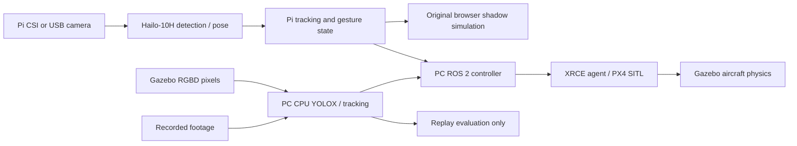

# GARUDA / Microchip demo: implementation and handover

Recorded 2026-11-01; implementation through `1d28872` on `feat/px4-gazebo-demo`. This document joins the October/November work into one account. Historical measurements remain in [benchlog](../bench/benchlog.md), environments in [versions](../bench/versions.md), and design decisions in [decisions](decisions.md). Use the [installation and operator guide](DEMO_USER_GUIDE.md) to run it.

## Delivered experience

The main browser window opens the original Microchip-branded GARUDA camera demo, with Hailo-10H attribution and a simulated shadow aircraft. A button switches within that window to the PC flight lab, where real ROS 2 messages command a PX4 software-in-the-loop aircraft in Gazebo. The Pi camera stays the main image. Gazebo is a separate live scene/vehicle visualization, not a prerecorded substitute for that camera.

The original view remains independently accessible at `http://10.42.0.128:8098/demo`. The main PC launcher is `http://127.0.0.1:8100/`. Gazebo and QGroundControl have native windows; the two web views share one browser window. Switching views does not terminate an active simulation.

The branding demonstrates a Microchip autonomy concept with Hailo perception. The current lab does not contain the proposed CA90 flight controller, nor does it demonstrate real aircraft flight. Keep these distinctions in booth narration.

## Work completed, in order

| Stage | Change and reason | Evidence / revision |
|---|---|---|
| October 24, Ethernet recovery | Restored PC–Pi link and preferred `pi-share` over the competing Hailo-15 network profile | Session account; working address `10.42.0.128` |
| October 24, camera investigation | Traced missing GUI feed through capture discovery, firmware/runtime probe and I2C; repeated reseats across CSI connectors found no response | Cable/module suspected; known-good replacement still pending |
| October 24, publication | Created Pi and Hailo-15 snapshot repositories with user guides; recordings excluded from Hailo-15 snapshot | Pi remote main `f19835a3347fb0c754103d158bea942cdbfc5e4f` |
| October 31, USB fallback | Added V4L2 capture, CSI-preferred auto-selection and re-probe after source failure | `515421d`, `158dfff`; USB 1280×720 observed |
| October 31, booth console | Added `/demo`: annotated feed, click-to-lock, virtual gimbal crop, lock/coast/search state, gesture readout, captions, telemetry and attract overlay | `570185c` |
| Shadow flight | Added tactical map, vehicle/target trails, follow gap, hold on loss and loiter; bounded position controller gives acceleration/yaw response | `dcfe3dd` |
| Brand and return behavior | Microchip/Hailo-10H branding, brake/hold behavior, guarded appearance-based returning-person matching | `943234f`, `0b8f249` |
| Face and visitor controls | Optional CPU face matching, adjustable follow gap, gesture controls, prominent readout and compact fullscreen layout | `2652378`, `81e3f49`, `8768dad` |
| Flight gestures and T-pose | Added simulated takeoff/land/orbit; mapped poses to actions; fixed stretched-arm T-pose and orbit travel fit | `53a854b`, `fe50212`, `99db1c5` |
| Preserve original | Tagged and archived working Pi deployment before PC integration | `582732e`; baseline `99db1c5`, tag `demo-working-20261031` |
| November 1, ROS/PX4 | Built isolated PC DDS/ROS controller and Gazebo/PX4 session; verified takeoff/landing | `e8f76af` |
| Camera-first lab / footage | Restored Pi feed as primary, improved follow mapping, introduced rendered RGBD detection and recorded-footage evaluation | `68491d0` |
| Unified navigation and setup | Iterated initial two-view UI into one original-first window; start controls, auto-discovery/saved paths, pose-mode setup | `6ae663c`, `8ef5918` |
| Next work saved | Recorded seven prioritized visitor/readiness/evaluation improvements | `0802f26`; [backlog](../hosts/pc/README.md#next-things-to-do--saved-2026-11-01) |
| Close/reopen fix | End owned PX4 when Gazebo closes, reset controller/DDS on fresh sessions, explicit reset clears stale flight/target authority | `1d28872` |

The October hardware narrative combines the supplied session account with repository records. An empty I2C scan strongly narrows diagnosis but does not prove which component failed; “software fully ruled out” is stronger than the completed evidence supports. Power off before CSI cable work.

## Architecture and code ownership

The recorded-footage source disables flight commands; the shared vision service diagram does not imply replay can fly PX4. Pi tracking is consumed over HTTP/state polling; the original browser uses the existing event feed. The controller runs its ROS loop at 20 Hz and polls Pi perception at 5 Hz. These are configured rates, not measured end-to-end throughput promises.

| Area | Main files |
|---|---|
| Pi capture/inference/server | `hosts/pi5/garuda_mono.py`, camera/model adapters beside it |
| Original demo | `hosts/pi5/demo/index.html` and its browser controller assets |
| Optional face worker | `hosts/pi5/mono_faces.py`, `models/fetch_faces.py` |
| Main PC launcher/config | `hosts/pc/lab_launcher.py`, `hosts/pc/demo.html` |
| Process lifecycle/world | `hosts/pc/start_sitl.py`, `hosts/pc/lab_processes.py` |
| ROS adapter/controller | `services/garuda-follow/sitl_demo.py` and its core |
| PC vision | `hosts/pc/vision.py`, `hosts/pc/gazebo_pixels.py` |
| Replay measurements | `bench/vision_replay.py`, `bench/results/2026-11-01-pc-visual/` |
| Reproducible ROS environment | `pixi.toml`, `pixi.lock`, `hosts/pc/prepare_messages.py` |

The Hailo-15 project contributed the rendered-camera/world approach and access to existing aerial footage. Its branch remained separate (`b57dd5e` recorded for reused material); the PC experiments do not measure Hailo-15 or Hailo-10H acceleration.

## Target selection, return and face matching

Both demos require an explicitly selected target. Track IDs can change after a person leaves the frame. Appearance matching provides guarded recovery instead of treating every new ID as the same person.

The PX4 implementation uses 128-dimensional appearance features with a cosine threshold of 0.90, a 0.10 ambiguity margin, four distinct observations and 0.8 seconds of dwell within a 30-second return window. It excludes already co-visible bystanders as return candidates. These are code settings, not measured identity accuracy. Similar clothing and lighting changes can still confuse matching; uncertain returns need operator confirmation.

The original Pi browser demo additionally supports optional YuNet/SFace processing on CPU. It is bounded auxiliary work alongside Hailo detection. Browser/session enrollment is not backed by a shared identity database and is not included in the recovery archive. **The PX4 lab does not use face confirmation**; enabling faces in the original view does not establish face-authorized PX4 commands.

## Follow, orbit and control limits

In live Pi mode, box center gives bearing and apparent person height gives a schematic range. The target is mapped into the booth's simulated coordinates, then follow gap is applied. This reproduces the original browser demonstration's feel; it does not locate a moving person accurately in a calibrated Gazebo/world frame. Physical depth calibration remains open.

In drone-camera mode, detections come from rendered RGB pixels. RGB and depth frames must match timestamps; torso depth is filtered and projected using camera geometry and PX4 attitude. Actor ground-truth coordinates do not enter the controller. This is the stronger visual-control experiment, but still requires more live orbit testing.

The PX4 lab exposes gap, speed, travel limit and clockwise/counterclockwise orbit controls. Current limits include speed up to 2 m/s, gap 0.5–5 m, travel radius 3–15 m, acceleration cap 0.8 m/s² and yaw-rate cap 0.6 rad/s. These are simulator settings, not a real-aircraft operating envelope. Orbit generates translational positions around the selected target.

Loss/coasting causes Hold rather than extrapolating a hidden person indefinitely. A camera-session/source change clears selection authority. Fresh position/status thresholds are separate from target freshness; missing PX4 telemetry stops offboard heartbeat and faults the controller. The PX4 failsafe then owns vehicle behavior.

## Gestures and UI behavior

The selected live Pi pose track supplies `follow_me` (one raised arm), `circle` (T-pose), `land` (crossed arms), and `stop` (both hands up). Hold is immediate; other PX4 actions require 1.2 seconds of sustained fresh observations and fire once per onset. Keep both wrists and the upper body visible; release the pose before repeating it.

Enabling PX4 Flight gestures explicitly switches the shared Pi detector to pose through its existing API. This is a runtime mode change, not a deployment/service/package change. Switching modes may create new IDs, so reselect. Disabling PX4 gestures does not automatically revert the detector. The synthetic actor and recorded footage do not have this gesture path.

Gesture prominence and compact fullscreen layout were improved in the original view. A richer skeleton/joint explanation and guided visitor challenge are still backlog items, not delivered features.

## Lifecycle, portability and isolation

The standard-library launcher works before ROS is available. It discovers common paths and saves explicit choices in `.runtime/lab-config.json`; it checks prerequisites but does not install them. The Pi's own paths remain less portable and are documented in the guide.

The isolated session uses ROS domain 42, `/garuda_sitl`, XRCE UDP 8889, PX4 instance 3/system ID 4 and Gazebo partition `garuda_isolated`. QGC has separate settings directories. Commands require `GARUDA_SIM=1`. PID/start-time checks limit process cleanup to owned runtime processes; this is not authorization for real hardware flight.

The stale-telemetry failure occurred after closing/reopening Gazebo while old controller/DDS state retained the previous session. The fix runs PX4 in daemon mode, supervises its owned Gazebo lifecycle, cleans descendants, and refreshes managed controller/agent state on a new SITL start. Explicit reset discards a stuck simulated flight and clears selection/gesture authority. Merely switching web views does not reset anything.

The original Pi service, deployment and Hailo packages were preserved throughout the PC work. Full baseline identity/archive/checksum and restoration steps are in [isolation and recovery](px4-demo-isolation.md). Stopping the PC lab and opening the direct Pi URL is the normal fallback; restoring an archive is unnecessary unless deployment files were actually altered.

## What was verified and what was not

The following summarizes existing logs; writing this documentation did not rerun flight or hardware tests.

| Evidence | Result and limit |
|---|---|
| Initial SITL harness | Takeoff and landing passed on November 1 |
| Visual follow trace | Follow motion recorded in 83 of 124 trace samples; max commanded speed 0.66076 m/s; 2.5-second target dropout produced Hold; landed/disarmed |
| Orbit interval | Only 0.456 radians before operator interruption; not a complete-circle pass |
| Live PX4 gesture fix | Hold then takeoff/follow observed with fresh selected pose track; flying/armed telemetry confirmed; full gesture sequence not certified |
| Session recovery | Stale cached armed/FAULT reproduced; explicit reset restored fresh GROUND/disarmed and cleared selection/gestures |
| Close/reopen regression | Closing owned Gazebo ended wrapper/PX4; next Start obtained fresh GROUND/disarmed without manual DDS repair |
| Unit checks at code milestones | Follow core, launcher lifecycle and vision tests recorded in benchlog; no hardware-flight claim |
| VisDrone 120 frames | 108 matched, 12 missed, 90% coverage, four loss events, three matched-ID changes for recorded clip/configuration |
| CPU runtime observations | OpenCV DNN 2.7256 fps, p95 415.16 ms; ONNX Runtime 6.9556 fps, p95 155.63 ms, under different load; not a controlled speedup comparison |

Replay reports and interpretation: [visual evaluation evidence](../bench/results/2026-11-01-pc-visual/README.md). Metrics concern annotated SOT coverage at IoU ≥ 0.5, not IDF1/HOTA or overall detector accuracy. Do not attribute PC CPU throughput to Hailo.

Pi thermal throttling was observed at 82.9 °C after roughly 29 minutes of detection (`0x80008` at that observation). Other sessions have different sticky throttle flags. Throttled runs are not accepted as sustained throughput evidence. Earlier July/August model benchmarks describe different configurations and must retain their dates.

## Outstanding work and show readiness

Before calling this reproducible/show-ready: fit active cooling and run a sustained soak; replace/test the CSI cable/module; physically validate depth at the booth; complete both orbit directions and all gestures with competing people/occlusions; repeat clean-close/reopen and network-loss scenarios; perform a clean installation on another PC and Pi with a matched model/package manifest.

The saved product backlog is: clearer pose feedback, component readiness/recovery, guided Follow me challenge, visible target-loss explanation, controlled footage performance comparisons, inactivity presentation mode, and a version-aware portable setup wizard. The first three have priority. See [the maintained checklist](../hosts/pc/README.md#next-things-to-do--saved-2026-11-01).

The next publication step is the [garuda-pi5 update plan](GARUDA_PI5_UPDATE_PLAN.md). It preserves the old snapshot's unique files, reconciles its installation guide, and stages a reviewable update without replacing the working Pi deployment.
