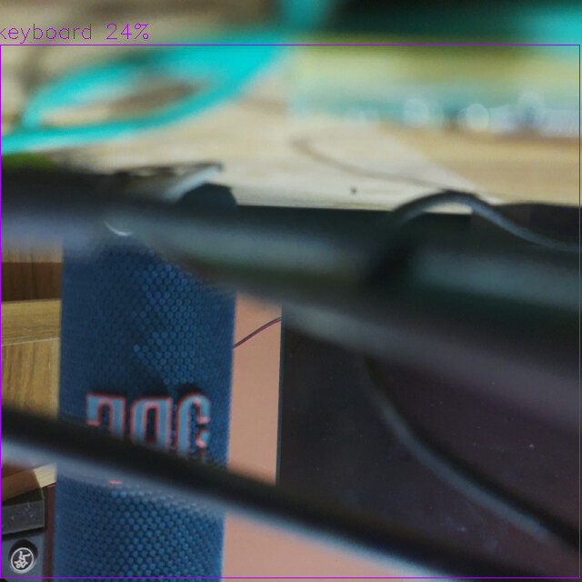

# garuda-portal — the browser configurator

A single-page web application served directly from the Raspberry Pi, for bringing up,
inspecting, tuning, and validating the board. No client-side install: it works from any
browser on the same network — a laptop or a phone. This document describes what it does and
how it is built. The original design spec and the task-by-task implementation plan are in
[`superpowers/specs/`](superpowers/specs/) and [`superpowers/plans/`](superpowers/plans/).

Reach it at `http://<pi-ip>:8080/` (on this bench, `http://10.42.0.128:8080/`).

---

## Who it is for

Designed for the **integrator** bringing up a drone on the board, with an architecture that
stages cleanly to two later personas: the **bench developer** (raw diagnostics) and the
**field operator** (a pre-flight go/no-go card — which the Readiness panel already is).

---

## Panels

| Panel | What it does |
|---|---|
| **Overview** | Live SoC temperature, `vcgencmd` throttle flags, per-service state, disk, uptime, and package versions. Updated continuously over Server-Sent Events. |
| **Camera** | Live MJPEG stream from the Camera Module 3, and a still-capture button. |
| **Inference** | Start/stop on-NPU YOLOv8m detection. Shows a **live annotated video feed — bounding boxes drawn on the Hailo-10H — alongside a structured detection list** (class, confidence). One camera holder produces both the annotated pixels for the human and the structured detections for the autonomy stack. |
| **Calibration** | A guided camera-intrinsics wizard: enter the checkerboard geometry, then capture frames while a 3×3 coverage grid fills in; solve on-board with OpenCV and get a reprojection-error verdict (green < 0.5 px, amber < 1.0 px). The result is stored per sensor. Cam-IMU and stereo-extrinsics stages are rendered as staged, disabled cards — the UI teaches the full calibration path without faking data for hardware that isn't here yet. |
| **Readiness** | An automated **go / caution / no-go** card. Runs a declarative registry of checks (NPU identify, camera cadence, power/throttle flags, 5 V/5 A supply advisory, PTP lock, core services, storage, thermals, bridge session) and renders a per-check pass/warn/fail/n-a report, downloadable as a pre-flight record. This card becomes the field-operator page unchanged. |
| **Settings** | Bridge endpoint (agent IP/port), PTP role, and other config — written through the validated whitelist, with rejection reasons surfaced. |
| **System** | Journal excerpt viewer and reboot. |



---

## Architecture

Two processes on the Pi, separated by a privilege boundary:

```
browser ──HTTP / SSE / MJPEG── garuda-portal        (unprivileged, User=garuda)
                                     │
                                     │  Unix socket /run/garuda/configd.sock  (root:garuda 0660)
                                     ▼
                                garuda-configd        (root, whitelist-only executor)
```

- **`garuda-portal`** (unprivileged): a Python standard-library HTTP server — no web
  framework, no build toolchain. Serves the static single-page UI, a small REST API, a
  Server-Sent-Events stream for live data, and the MJPEG camera/inference video. It reads all
  its data from the same probes used elsewhere on the bench (`vcgencmd`, `hailortcli`,
  `systemctl`, PTP state, the inference detection feed).
- **`garuda-configd`** (root): a tiny daemon listening on a Unix socket that executes **only
  whitelisted operations** — schema-validated config get/set and start/stop/restart of
  `garuda-*` services. Everything else is rejected and audit-logged. The portal is its only
  client. This is the single security surface, and it fails closed on any malformed input.

**Config store:** `/etc/garuda/config.json`, written atomically by configd — the single
source of truth services read at startup.

The REST/stream API is the real contract; the plain-HTML/JS skin is deliberately replaceable
(a richer frontend could be swapped in against the same API without backend changes).

### The camera-ownership state machine

The Camera Module 3 is a single-client device — the raw MJPEG stream and the inference
pipeline cannot both hold it. `InferenceManager` is the switch: exactly one of them owns the
camera at any moment (`mode` ∈ `{"stream", "inference"}`). Entering inference mode stops the
raw stream and spawns the inference child; the annotated JPEG frames it produces are served
at `/api/stream` in place of the raw feed, and its structured detections are published on the
event bus. Leaving inference mode reverses this. The transition is locked and idempotent, and
if the inference child dies on its own the manager recovers to stream mode rather than leaving
the camera dark.

---

## API surface

| Method & path | Purpose |
|---|---|
| `GET /api/health` | Snapshot: temps, throttle flags, NPU, services, disk, camera mode. |
| `GET /api/events` | Server-Sent Events: health ticks, detections, mode changes. |
| `GET /api/stream` | MJPEG — raw camera in stream mode, annotated inference in inference mode. |
| `GET /api/config` · `PUT /api/config` | Read / write whitelisted config (through configd). |
| `POST /api/actions/inference` | Start/stop on-NPU inference (the camera-ownership switch). |
| `POST /api/actions/service` | Start/stop/restart a `garuda-*` service (through configd). |
| `POST /api/actions/capture-still` | Save a still from the current stream. |
| `GET /api/models` | List installed Hailo HEF models. |
| `GET /api/readiness/report` | Run the readiness checks fresh; returns the go/no-go report. |
| `POST /api/actions/calib-*` · `GET /api/calibration/status` | The calibration wizard. |
| `GET /api/logs` | Recent journal excerpt. |

The portal never exposes an arming or offboard command. That is an absolute safety line.

---

## How it was built

The portal was implemented **test-first with a multi-agent review workflow**: a written design
spec, a task-by-task implementation plan, then ten tasks each built by a fresh agent, reviewed
for spec-compliance and code quality, fixed where the review found issues, and finally a
whole-branch review before merge. The review passes caught real defects that a straight-line
build would have shipped — among them a root daemon that a disconnecting client could crash, a
streaming handler that leaked a thread per disconnect, tests that asserted against their own
copied logic instead of the real code, a readiness engine that crashed on degraded input, and
a path-traversal via unsanitised calibration filenames. All were fixed and re-verified.

**83 automated tests** run on any Linux box without Pi hardware (probes and the camera are
dependency-injected); the OpenCV calibration math is verified against synthetic camera
geometry with a known focal length. It is deployed on the bench as two systemd services via
the idempotent [`hosts/pi5/install.sh`](../hosts/pi5/install.sh).

```bash
python3 -m pytest services/ -v      # full suite, no hardware required
```

---

## Security posture (read before exposing off the bench)

The portal is a **bench/development tool on an isolated LAN**. Two changes are **hard
requirements** before it is exposed anywhere else (product tier / Phase 8), and are tracked in
[`decisions.md`](decisions.md):

1. **Authentication.** It is currently unauthenticated on `0.0.0.0:8080` — any host on the LAN
   can change configuration and start/stop services. No auth scheme exists yet.
2. **A non-sudo service account.** On the bench the `garuda` account has passwordless sudo, so
   the portal/configd privilege split is architectural intent rather than enforced containment
   here; it becomes real only when the deployed account holds no sudo.
